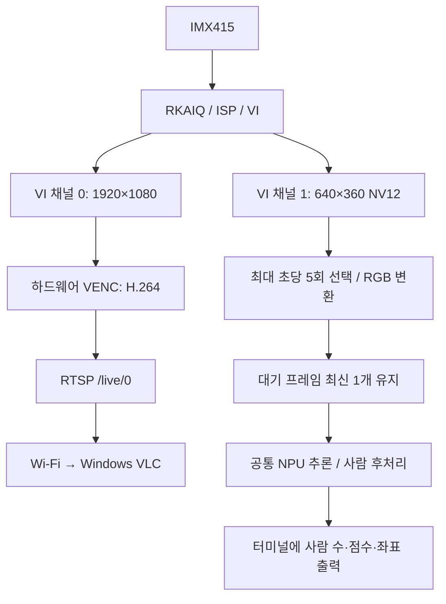

> 과거 구현/검토 기록입니다. 현재 동작 설명은 작업 소스 README.md와 최신 H.265 전달본을 우선합니다. 2026-10-27 현재 송출 코드는 HEVC/H265CBR이며 ARM 빌드·VLC 검증은 대기 중입니다. 본문의 H.264 설명과 당시 검증 범위는 과거 상태를 나타냅니다. NPU 동시 실행 타임아웃은 미해결입니다.

# Luckfox Pico Zero 사람 감지 구축 기록

> 2026-09-20 진단 소스 추가: 센서 드라이버 조회에서 현재 10비트 해상도 3864×2192와 20/30fps 프레임 간격 항목을 확인했다. 현재 FPS 측정값은 아니다. 원인 분리를 위해 `-D` 모드를 추가했다. 두 VI 채널과 NPU를 유지하고 VENC/RTSP를 생략하며 메인 VI는 사용자 스레드가 받아 반환한다. 이 추가분은 ARM 빌드·보드 시험 전이며, 기본 실행에는 적용하지 않는다.

> 2026-09-20 재대조: 기존 스트리밍 종료 후 동일 이미지에서 24명 검출, 98.3ms로 다시 성공했다. 스트리밍 없음→있음→없음 조건에서 성공→시간 초과→성공을 확인했다. 커널 5.10.160 및 보드의 v4l2-ctl 존재를 확인하여 센서/ISP 설정 조사를 이어간다.

> 2026-09-20 분리 시험 결과: 기존 RTSP 예제를 실행한 상태에서 별도 프로세스인 이미지 추론 프로그램도 약 6.15초 후 NPU timeout으로 실패했다. 새 통합 프로그램의 보조 VI·카메라 RGB 변환·스레드 구조 없이도 재현됨을 확인했다. 카메라 동작과 NPU 실패의 연관성이 강화됐지만 버스·드라이버·하드웨어 중 근본 원인은 미확정이다.

> 2026-09-20 커널 추가 확인: RKNPU 작업이 6초 제한을 넘겨 약 6.5초 대기 후 시간 초과와 soft reset을 기록했다. 센서 입력 3864×2192 및 ISP의 `force to 2 readback` 메시지도 확인됐다. 원인 확정 전이며 기존 RTSP 예제와 단독 이미지 프로그램을 동시에 실행하는 분리 시험을 다음 단계로 정했다. 해당 시험은 아직 미실행이다.

> 2026-09-20 후속 시험: 아래 본문은 9월 18일 구축 시점의 기록이다. 첫 실시간 통합 실행에서 NPU 메모리 초기화, IMX415 AIQ 및 두 VI 채널 시작, H.264 출력까지 성공했고 초기 VIDEO fps=20.1이 관측됐다. 그러나 PERSON 결과 없이 RKNN failed to submit / rknn_run -1로 종료됐다. VLC 수신 및 실시간 감지 성공은 미확인이다. 커널 로그로 원인을 조사하는 단계이며 본문의 단일 이미지 성공과 구분한다.

작성일: 2026-09-18  
범위: 소스 구성, ARM 빌드, 보드 단일 이미지 검증까지. 실시간 스트리밍과 NPU 동시 실행은 아직 시험하지 않았다.

## 1. 목표와 현재 결과

Luckfox Pico Zero와 IMX415로 촬영한 영상을 Wi-Fi를 통해 Windows VLC로 전송하면서, 보드의 NPU로 사람이 있는지 감지하는 프로그램을 구축했다. 사람 객체의 위치와 개수를 검출하는 기능이며 특정 개인을 식별하는 기능은 아니다.

먼저 카메라와 네트워크 영향을 제외한 이미지 한 장으로 NPU를 검증하도록 실행 파일을 분리했다. 이후 같은 추론 코드를 카메라 스트리밍 프로그램에서 재사용하도록 구성했다.

현재 두 실행 파일의 ARM 교차 빌드가 성공했고, 보드에서 612×368 이미지에 포함된 24명을 검출하여 박스가 그려진 결과 JPG를 저장했다. 단일 이미지의 전처리·추론·후처리 합계는 98.0ms였다. 이는 실시간 FPS나 영상 전송 지연 측정값이 아니다.

## 2. 개발·실행 환경

| 구분 | 확인된 환경 |
| --- | --- |
| 보드 / 카메라 | Luckfox Pico Zero / IMX415 |
| 보드용 대상 | RV1106 계열, ARM 32비트 uClibc |
| 보드 RKNN runtime | 1.6.0, 빌드 식별자 2de554906@2024-01-17T14:53:41 |
| 보드 NPU driver | 0.9.2 |
| 빌드 환경 | Ubuntu x86_64 VM, 사용자 student |
| 교차 컴파일러 | arm-rockchip830-linux-uclibcgnueabihf GCC/G++ 8.3.0 |
| OpenCV | vendor 제공 4.10.0, core/imgproc/highgui 사용 확인 |
| VM Python | Conda base 3.7.3; Toolkit2 설치 여부·버전 미확인 |
| 실제 스트리밍 검증 환경 | Wi-Fi 핫스팟 + Windows VLC Media Player |

VM 프로젝트 경로는 `/home/student/cctv_person_npu`, vendor 예제 경로는 `/home/student/RKMPI/luckfox_pico_rkmpi_example`이다. 교차 컴파일러는 다음 경로에서 발견됐다.

```text
/home/student/luckfox-live/luckfox-pico/tools/linux/toolchain/
  arm-rockchip830-linux-uclibcgnueabihf/bin/
  arm-rockchip830-linux-uclibcgnueabihf-g++
```

위 표기는 읽기 위해 줄을 나눈 하나의 경로다. `LUCKFOX_SDK_PATH`와 `GCC_COMPILER` 환경변수가 없어도 PATH에 있는 컴파일러를 찾도록 구성했다.

Codex는 Windows 작업공간에서 소스를 작성·수정했다. VM 및 보드 명령은 사용자가 실행하고 결과를 전달했다. Visual Studio SSH 세션에 Codex가 직접 접속하여 빌드하거나 배포한 것은 아니다.

## 3. 기존 구성에서 재사용한 부분

기존 `simple_vi_bind_venc_rtsp`로 IMX415 촬영과 H.264 RTSP 전송을 확인했다. 사용자가 `-b 4096` 적용 후 Wi-Fi 끊김이 없어졌다고 보고하여 새 프로그램도 기본 비트레이트를 4096Kbps로 설정했다. 이 결과는 기존 스트리밍 예제의 관측이며 새 NPU 통합 프로그램의 성능 검증과는 구분한다.

센서 제어에는 RKAIQ를 사용하고 기본 IQ 경로를 `/etc/iqfiles`로 설정했다. 기존 성공 로그에서 선택된 파일은 `imx415_CMK-OT2022-PX1_IR0147-36IRC-8M-F20.json`이다. 새 통합 프로그램의 IQ 초기화는 아직 보드에서 검증하지 않았다.

사용자가 제공한 RKNN 가이드의 PC 모델 변환 → ARM C/C++ 빌드 → 보드 이미지 검증 순서를 반영했다. 기존 `luckfox_pico_rtsp_yolov5`의 모델과 RKNN 메모리 바인딩·후처리 방식을 참고하고, 별도 `cctv_person_npu` 프로젝트로 구현했다.

현재 모델은 기존 `model/yolov5.rknn`을 복사한 것이다. 새 모델 학습이나 RKNN 재변환은 수행하지 않았다. 생성 당시 Toolkit 버전과 원본 ONNX는 미확인이지만, 현재 보드에서 단일 이미지 실행은 성공했다.

```text
모델 SHA256
7e72c8caa060ea15d69109e4af6c1f80005cbd1be14bbe1f6f2af9175861c44a
```

## 4. 파일 구성과 책임

| 파일 | 역할 |
| --- | --- |
| `src/image_main.cc` | JPG 읽기, 공통 추론 호출, 검출 로그 및 결과 JPG 저장 |
| `src/main.cc` | IMX415 초기화, VI/VENC/RTSP 연결, AI 영상 수집 및 추론 스레드 |
| `src/npu_model.cc` | 모델 로딩, 입출력 속성 검사, NPU 메모리 할당·바인딩, 전처리와 추론 |
| `src/person_decode.cc` | INT8 출력 해석, person 필터링, 중복 박스 제거, 원본 좌표 복원 |
| `include/` | 추론 클래스와 후처리 데이터 구조 선언 |
| `CMakeLists.txt`, `build.sh` | 교차 컴파일러·vendor 라이브러리 탐색, 빌드 및 dist 설치 |
| `tools/check_vm.sh` | VM 컴파일러·라이브러리·Python 환경 확인 |
| `tools/convert_rv1106.py` | 향후 ONNX를 RV1106 INT8 RKNN으로 변환하기 위한 도구 |
| `tests/` | 보드 없이 수행하는 후처리 및 변환 입력 경로 검증 |
| `model/yolov5.rknn` | 보드 검증에 사용한 기존 모델 |

현재 Windows 소스 위치는 `C:/Users/ohhoj/Downloads/Luckfox/cctv_npu_output_fix_complete/cctv_person_npu`이다. 배포 소스에는 실행 바이너리가 없고, VM에서 빌드한 `dist`가 보드 배포 대상이다.

## 5. 이미지 한 장 처리 흐름 — 보드 검증 완료

```text
person.jpg
  → OpenCV로 BGR 이미지 읽기
  → RGB 변환
  → 비율 유지 리사이즈 + 여백 추가로 640×640 구성
  → RKNN 입력 메모리 복사
  → 보드 NPU 추론
  → 3개 INT8 출력 해석
  → person 선택 + 중복 박스 제거
  → 원본 이미지 좌표 복원
  → 터미널 출력 + result.jpg 저장
```

### 전처리

원본 비율을 유지하며 리사이즈하고 남는 공간을 RGB 값 114로 채운다(letterbox). 검출 후에는 여백을 빼고 실제 리사이즈 비율을 역으로 적용하여 원본 좌표로 돌아간다. 정수 크기로 반올림한 영향을 반영하기 위해 가로·세로 비율을 각각 사용한다.

모델 native 입력은 INT8 NHWC이며, 입력 API에는 UINT8 RGB 픽셀을 지정한다. 런타임이 정규화·양자화를 처리하도록 구성하여 CPU에서 255로 나누는 처리를 중복 적용하지 않는다. RKNN 메모리 바인딩 API를 사용하지만 전처리와 픽셀 복사는 CPU에서 수행하므로 전체 경로가 무복사인 것은 아니다.

### 모델 입출력과 메모리

`rknn_init` 후 입력 1개·출력 3개인지 확인하고 타입, 차원, 양자화 속성을 검사한다. 현재 구현은 아래 640×640 COCO YOLOv5 출력 구조를 대상으로 한다.

| 텐서 | NHWC 차원 | 논리 데이터 바이트 | 할당 바이트 |
| --- | --- | ---: | ---: |
| 입력 | 1×640×640×3 | 1,228,800 | 1,228,800 |
| 출력 0 | 1×80×80×255 | 1,632,000 | 1,638,400 |
| 출력 1 | 1×40×40×255 | 408,000 | 409,600 |
| 출력 2 | 1×20×20×255 | 102,000 | 102,400 |

위 값은 실제 보드 로그다. 입력·출력의 native 타입은 INT8, zero point는 -128, scale은 약 0.00392157이었다. 입출력 할당 합계는 3,379,200바이트이며 모델 가중치·내부 작업 메모리·카메라 버퍼는 포함하지 않는다.

`rknn_create_mem`은 `size_with_stride`만큼 할당하고 `rknn_set_io_mem`으로 연결한다. 후처리에는 논리 `size`를 전달한다. 출력 255채널 읽기 방식을 유지하며 할당 크기만 보고 256채널로 해석하지 않는다. 크기·타입 검사는 유지하고 할당 영역이 논리 데이터보다 작은 경우는 거부한다.

### 후처리

각 위치의 255개 값은 3개 anchor × (박스 4값 + 객체 점수 1값 + 클래스 80값) 구조로 읽는다. INT8 값은 `(값 - zero_point) × scale`로 복원한다. 현재 지원 모델의 sigmoid 적용 출력을 사용하므로 sigmoid를 다시 적용하지 않는다.

80개 클래스 중 가장 높은 클래스가 `person`(class 0)인 후보만 선택한다. 최종 점수는 객체 점수 × person 클래스 점수이며 기본 임계값은 0.5다. 점수순으로 정렬한 뒤 IoU 0.45를 초과하는 중복 박스를 억제하는 NMS를 적용한다. 마지막으로 원본 좌표로 복원하고 이미지 밖 좌표를 제한한다.

## 6. 실시간 처리 흐름 — 소스 구현·ARM 빌드 완료, 보드 실행 미검증



영상 경로는 VI와 VENC를 하드웨어 바인딩하여 구성했다. 설정은 1920×1080, H.264 CBR, 4096Kbps, GOP 30이다. RTSP 포트는 554이고 경로는 `/live/0`이다. 1080p는 출력 해상도이며 센서 입력도 1080p로 설정했다는 의미는 아니다. 기존 센서 로그는 3864×2192였다.

AI 경로는 별도 VI 채널의 640×360 NV12 영상을 받는다. 유효 영상 크기와 실제 메모리 행 간격을 구분하여 Y·UV를 복사한 뒤 RGB로 변환한다. 기본 `-f 5`는 AI 입력을 최대 초당 5회 선택하는 설정이며 실제 영상 FPS 설정이 아니다. 이 채널 조합이 현재 IMX415/ISP 구성에서 동작하는지는 실시간 시험에서 확인해야 한다.

영상 송출 스레드, NPU 추론 스레드, 메인 스레드의 AI 프레임 수집을 분리했다. 추론이 느려질 때 오래된 프레임이 쌓이지 않도록 처리 대기 슬롯은 하나만 유지하고 새 프레임으로 교체한다. 영상 송출 코드가 추론 결과를 기다리지는 않지만 CPU·메모리·하드웨어 자원은 공유하므로 성능 영향이 없다고 보장하지 않는다.

추론 좌표는 640×360 영상으로 복원한 뒤 1920×1080 기준으로 환산하여 출력한다. 두 채널이 같은 화각을 제공한다는 전제이며 실시간 시험에서 확인해야 한다. 현재 VLC 영상에 검출 박스를 합성하는 기능은 없다. 단일 이미지의 JPG 박스 표시와 구분한다.

### 실행과 종료 처리

모델을 먼저 초기화하여 모델 오류가 있으면 카메라를 열기 전에 종료한다. 이후 카메라 장치가 이미 활성화돼 있는지 확인하며 다른 카메라 앱을 자동 종료하지 않는다. SIGINT/SIGTERM을 받으면 스레드를 정리하고 VI/VENC/RTSP/AIQ 및 NPU 메모리를 해제하도록 구현했다. 영상 또는 AI 프레임을 5초 동안 받지 못하면 오류 처리한다. 이 종료·오류 처리도 통합 실행에서 별도 확인이 필요하다.

| 옵션 | 기본값 | 의미 |
| --- | --- | --- |
| `-b` | 4096 | H.264 비트레이트, Kbps |
| `-f` | 5 | AI 입력 선택 빈도의 상한, 회/초 |
| `-t` | 0.5 | 사람 검출 점수 임계값 |
| `-a` | `/etc/iqfiles` | IQ 디렉터리 |
| `-m` | 실행 파일 옆 `model/yolov5.rknn` | 모델 경로 |
| `-I` | 1 | 보조 VI 채널 번호, 1 또는 2; 실제 지원 여부 확인 필요 |

`detect_ms`는 RGB 영상의 letterbox 전처리부터 NPU·후처리까지다. `result_age_ms`는 AI 프레임을 프로그램에서 받은 시점부터 결과까지이며 NV12 변환과 대기도 포함한다. `VIDEO fps`는 인코더 출력 수로 계산한다. 어느 값도 센서에서 VLC 화면까지의 전체 지연을 직접 측정하지 않는다.

## 7. 빌드·배포 과정

VM에서 vendor 헤더와 ARM 라이브러리를 참조하여 C++11 프로그램을 빌드했다. 일반 PC용 OpenCV를 설치하여 해결하지 않고 보드 ABI에 맞는 vendor 라이브러리를 사용했다.

```sh
# Ubuntu VM에서 실행한 빌드
cd /home/student/cctv_person_npu
sh build.sh /home/student/RKMPI/luckfox_pico_rkmpi_example
```

빌드 후 `dist`에 `cctv_person_image`, `cctv_person_npu`, `model/yolov5.rknn`, README가 생성됐다. 사용자가 이 내용을 보드 `/oem/usr/bin/cctv_person_npu_demo`로 복사했다. 성공한 이미지 시험 명령은 다음과 같다.

```sh
# 보드에서 실행한 이미지 검증
cd /oem/usr/bin/cctv_person_npu_demo
./cctv_person_image model/yolov5.rknn person.jpg result.jpg 0.5
```

향후 모델 변환용 Python 도구는 고정 ONNX 입력과 출력 3개, sigmoid 출력 여부, calibration 파일 경로를 검사하고 RV1106 INT8 설정으로 변환하도록 작성했다. 그러나 실제 변환은 실행하지 않았다. 현재 변환 스크립트는 `importlib.metadata`를 사용하므로 사용자 Conda base Python 3.7에서 그대로 실행할 수 없다. 모델 변환을 진행할 때는 해당 Toolkit과 호환되는 Python 환경을 별도로 확인해야 한다. 보드 runtime 1.6.0과 VM Toolkit 버전은 서로 다른 항목이다.

## 8. 발생한 오류와 해결 근거

| 문제 | 확인한 원인·조치 | 확인 결과 |
| --- | --- | --- |
| VM 확인 도구의 importlib.metadata 오류 | Python 3.7에서 지원하지 않는 모듈 사용. 환경 확인 스크립트는 pip 정보 조회와 RKNN import를 분리하도록 수정 | Toolkit 설치 여부는 여전히 미확인; C++ 빌드는 별도로 성공 |
| OpenCV imgcodecs 누락 | imgcodecs를 필수로 지정한 설정을 변경하고 vendor 헤더 경로 보완. highgui 이미지 IO 컴파일·링크 검사 추가 | highgui 검사 및 이미지 실행 파일 빌드 성공 |
| main.cc/npu_model.cc 미발견 | VM에 필수 소스가 없는 상태. 패치 대신 전체 소스 묶음 제공 | 전체 소스 반영 후 ARM 빌드 성공 |
| Unsupported output layout | 논리 size와 할당 size_with_stride가 같아야 한다는 과도한 검사 | 할당 크기와 읽을 데이터 크기를 분리한 뒤 3개 출력 초기화 성공 |
| NPU output allocation failed | 커널에서 CMA 409600바이트 할당 실패 확인. 당시 rkipc 실행 중 | 종료 요청 후 CMA 점유 감소, 같은 모델의 이미지 추론 성공 |

메모리 오류 당시 일반 `MemAvailable`은 약 109MiB였지만 `rk-dma-heap-cma` 할당이 실패했다. rkipc 종료 요청 후 `CmaAllocated`는 85,180kB에서 12kB로 감소했고 다음 NPU 시험은 성공했다. 이는 기존 카메라 앱의 메모리 점유가 실패에 기여했음을 뒷받침한다. 프로세스별 전체 점유량을 측정한 것은 아니다.

종료 요청 후에도 한 차례 ps에 rkipc가 남아 있었으며 프로세스의 최종 상태는 확인하지 않았다. 이 펌웨어에서는 자원이 해제된 뒤에도 `CmaFree`가 0으로 표시됐으므로 그 수치 하나만으로 부족 여부를 판정하지 않는다. CMA 설정 증설, 강제 종료, 모델 축소는 이번 해결 과정에서 수행하지 않았다.

## 9. 검증 결과와 한계

PC에서는 후처리 CTest 1/1 및 변환 입력 경로 unittest 2/2 통과 기록이 있다. 후처리에는 사람 필터링, NMS, 좌표 복원, 잘못된 버퍼 크기 거부, 추가 할당 영역이 검출에 섞이지 않는 검사가 포함된다. 이 테스트들은 NPU 하드웨어 실행을 대체하지 않는다.

보드 시험에서는 다음 결과를 확인했다.

```text
NPU ready: RGB 640x640, COCO person class=0, INT8 output
PERSON count=24 image=612x368 detect_ms=98.0
```

원본은 6열×4행의 인물 24명 모음이며, 결과 JPG의 24개 박스가 각 인물과 대응했다. 육안으로 뚜렷한 누락이나 중복은 보이지 않았다. 일부 박스는 인접 칸까지 넘어갔고 라벨이 이미지 경계에서 잘리거나 겹쳤다. 일반 CCTV 장면, 먼 거리의 작은 사람, 가림, 야간에서의 정확도나 정량 지표는 측정하지 않았다.

원본: [person.jpg](C:/Users/ohhoj/Downloads/person.jpg)  
결과: [result.jpg](C:/Users/ohhoj/Downloads/result.jpg)

| 항목 | 현재 상태 |
| --- | --- |
| 기존 RTSP 예제의 Wi-Fi/VLC 재생 | 사용자 확인 |
| 새 프로그램 2종 ARM 빌드 | 성공 |
| 보드 모델 로딩·메모리 바인딩·단일 이미지 추론 | 성공 |
| 단일 이미지 결과 JPG 저장·박스 확인 | 성공 |
| 새 프로그램의 카메라 + NPU + RTSP 동시 실행 | 미검증 |
| 새 프로그램의 실시간 FPS·지연·장시간 안정성 | 미검증 |
| VLC 영상에 검출 박스 표시 | 미구현 |
| 추적 ID·이벤트 저장·서버 통보 | 미구현 |
| 새 모델 학습·ONNX→RKNN 실제 변환 | 미수행 |

SRS의 사람 감지 요구사항(WC-F-012)에 대한 기초 실행 경로를 검증한 단계다. 요구사항 전체 완료나 실시간 성능 달성을 선언하지 않는다.

## 10. 문서 작성 이후의 검증 계획

사용자 요청에 따라 현재는 구축 기록을 정리하는 단계이며 실시간 시험은 아직 시작하지 않았다. 이후 기존 카메라 앱이 자원을 점유하지 않는 상태에서 통합 프로그램을 실행하고, Windows VLC로 현재 보드 Wi-Fi 주소의 RTSP를 연다. DHCP 주소를 고정값으로 저장하지 않는다.

```sh
# 이후 보드에서 수행할 예정인 명령 — 실행 성공을 확인한 명령이 아님
./cctv_person_npu -b 4096 -f 5 -t 0.5
```

검증 항목은 카메라·NPU 동시 초기화, 빈 장면/사람 출입/여러 사람에서의 로그 변화, 인코더 FPS, 체감 지연과 끊김, CMA 상태와 장시간 온도다. 영상 박스를 추가하기 전 두 VI 채널의 화각과 좌표 대응도 확인해야 한다. 현재 카메라 뒷면 발열은 사용자가 관찰 사실만 기록하기로 했으며 카메라 온도 실측이나 정상/이상 판정은 하지 않았다.

## 11. 작성 근거

- 현재 로컬 소스: `cctv_npu_output_fix_complete/cctv_person_npu`의 CMake, main.cc, image_main.cc, npu_model.cc, person_decode.cc, 변환 도구.
- `CCTV_PROJECT_CONTEXT.md`의 빌드·보드 관측 기록과 사용자가 제공한 실행 로그.
- 사용자 제공 `rknn_guide.pdf`: `C:/Users/ohhoj/OneDrive/바탕 화면/rknn_guide.pdf`. 기존 작업에서 확인한 가이드 적용 내용을 반영했다.
- 기존 프로젝트의 `simple_test/simple_vi_bind_venc_rtsp.c`, `luckfox_pico_rtsp_yolov5` 예제.
- 외부 참고 위치: [Luckfox RKMPI 예제](https://github.com/LuckfoxTECH/luckfox_pico_rkmpi_example), [Rockchip YOLOv5 예제](https://github.com/airockchip/rknn_model_zoo/tree/main/examples/yolov5). 본 문서는 현재 로컬 구현과 사용자 관측을 기준으로 하며 외부 저장소 최신 버전과의 동일성을 보장하지 않는다.
