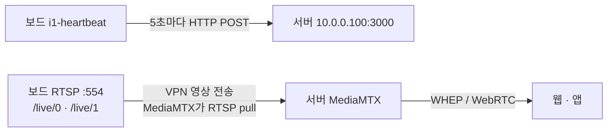

# I1 수정 및 I2 구현 검토

검토일: 2026-11-11. 대상: CAM-04AF / Luckfox Pico Zero + IMX415.

사용자가 제공한 두 PDF와 현재 로컬 코드를 대조한 분석이다. 프로그램·보드·서버 설정을 변경하거나 실기 시험을 수행하지 않았다. 문서 안의 설치·공유·테스트 지시는 검토할 요구사항으로 취급했으며 실행하지 않았다.

## 검토 자료와 기준

- [I2 계획 PDF](C:/Users/ohhoj/Downloads/4284019e-55a8-498a-99c6-3e236534321b_I2.pdf): 6쪽. 특히 3~5쪽의 영상 경로·결정 사항·완료 기준.
- [보드 To-Do PDF](C:/Users/ohhoj/Downloads/f85a983d-c197-4f58-9331-3cf474d55d03_보드.pdf): 8쪽. A는 보드2 I1 잔여, B는 보드1, C는 두 보드 영상, D는 H.265 재생 실패 시 대응.
- [프로젝트 기록](C:/Users/ohhoj/Downloads/Luckfox/CCTV_PROJECT_CONTEXT.md): 최신 실측을 우선. PDF의 11/9 저장소 기준 설명과 구분.
- [heartbeat 소스](C:/Users/ohhoj/Downloads/Luckfox/deliverables/i1_heartbeat_offline/i1_heartbeat/src/heartbeat.c), [프로토콜 소스](C:/Users/ohhoj/Downloads/Luckfox/deliverables/i1_heartbeat_offline/i1_heartbeat/src/protocol.c), [시작 스크립트](C:/Users/ohhoj/Downloads/Luckfox/deliverables/i1_heartbeat_offline/i1_heartbeat/S60heartbeat), [이중 RTSP 소스](C:/Users/ohhoj/Downloads/Luckfox/deliverables/cctv_dual_rtsp/dual_rtsp.c).

별도로 참조된 ICD I2 발췌 원문과 서버·클라이언트 상세 To-Do는 첨부되지 않았다. 이 보고서는 두 PDF에 명시된 인터페이스와 현재 구현의 차이를 다룬다. 운영 서버의 현재 배포 상태는 확인하지 않았다.

## 결론과 권장 구조

I1의 heartbeat를 전면 재작성할 필요는 없다. 기존 형식·5초 주기·재시도를 유지하고 목적지와 상태 검사 대상을 맞춘다. I2는 이미 있는 이중 H.265 RTSP를 운영용으로 배치하고 서버·브라우저까지 연결하는 작업이 중심이다.

heartbeat와 송출기는 별도 프로세스로 유지하는 구성이 적합하다. heartbeat는 선택한 송출기의 생존 상태를 참조한다. 보드에 WHEP/WebRTC 서버나 서버로 영상을 push하는 기능을 추가할 요구는 없다.

## I1에서 수정할 부분

| 항목 | 현재 확인 | 필요한 조치 | 구분 |
| --- | --- | --- | --- |
| 서버 주소 | heartbeat.c:21, S60heartbeat:7, 선택 conf 예제 모두 10.0.0.1 | 10.0.0.100:3000으로 소스·서비스·예제·안내를 일치시킨다. 서비스가 --host를 넘기므로 소스만 수정하면 적용되지 않는다. | 필수 수정 |
| WG 검사 대상 | heartbeat.c:161, S60heartbeat:10은 wg1. 최신 보드 설치본은 wg0 | 현재 wg0를 유지하면서 검사 기본값과 서비스 인자를 wg0로 맞춘다. 보드1의 wg1까지 바꾸거나 보드2를 wg1로 재구성할 필요는 없다. | 필수 수정 |
| 실제 VPN 전송 | WG_INTERFACE는 IFF_UP 검사에만 사용. libcurl에 CURLOPT_INTERFACE 설정 없음 | 목적지 10.0.0.100의 경로와 서버가 관측한 출발지 10.0.1.1을 확인한다. 인터페이스 강제 바인딩은 별도 설계 선택이며 단순 이름 수정과 구분한다. | 필수 검증 |
| rtsp_ok | rkipc_running()만 검사 (heartbeat.c:64,215) | cctv-dual-rtsp를 운영하면 해당 서비스/PID/실행파일 기준으로 변경한다. rkipc를 운영하면 기존 검사 유지 가능. | 송출기 선택에 따른 필수 수정 |
| 설정 파일 | S60heartbeat:12에서 /etc/heartbeat.conf를 선택적으로 읽음 | 사용자 선호인 별도 conf 없는 기본 동작 유지 가능. 새 conf를 필수로 만들 필요가 없다. 기존 conf가 있는 설치는 옛 주소가 기본값을 덮어쓰지 않는지 확인한다. | 구조 유지 |
| 시계 | 11/9 원본·사용자 INI의 rkipc NTP 비활성화 및 재부팅 UTC 보정 확인 | 시계 수정을 새로 구현할 필요 없음. 운영 영상 서비스 실행 중 UTC 유지 확인은 남아 있다. | 유지·추가 검증 |

wg_ok는 현재 인터페이스의 관리 상태 UP을 의미한다. 실제 WireGuard 핸드셰이크나 서버 도달 성공을 뜻하지 않는다. rtsp_ok 역시 문서상 프로세스 생존이며 실제 영상 정상 수신과 별도로 확인한다. 최근 프레임 시각 기반 건강 검사로 확장하는 것은 개선안이며 I2의 새 필수 JSON 필드로 추가하지 않는다.

보드2의 등록 식별자는 MAC 7424CA5004AF, device_id CAM-04AF, VPN IP 10.0.1.1이다. 서버 peer는 보드2 주소 10.0.1.1/32로, 보드의 서버 목적지 AllowedIPs는 10.0.0.100/32로 대조한다. 실제 새 서버 핸드셰이크와 실서버 HTTP 200은 이번 검토에서 확인하지 않았다.

### I1에서 그대로 유지할 부분

- POST /v1/devices/heartbeat, 5초 주기, libcurl 요청 제한과 다음 주기 재시도.
- mac/status/rtsp_ok/wg_ok/config_version의 기존 JSON. MAC 기본 인터페이스는 이미 wlan0이며 대문자·콜론 없는12자리 변환이 있다.
- config_version 요청값0과 200 응답 버전 로그. 응답의 device_id/mac 같은 추가 필드는 현재 버전 파서가 허용한다. 설정 다운로드·적용은 I2 필수 구현이 아니다.
- 요청 실패·400·403 후 종료하지 않고 재시도하는 동작.
- S60heartbeat 자동 시작 구조. 다만 재부팅 후 실제 HTTP 200까지는 별도 검증해야 한다. S50 다음에 실행된다는 순서가 핸드셰이크 완료를 보장하지는 않는다.
- I2 중 기존 i1-heartbeat 사용. BoardServer와의 프로그램 통일은 문서상 회고에서 결정한다.

보드 To-Do의 설치 스크립트를 통째로 실행할 필요는 없다. BoardServer의 설치 절차도 /etc/init.d/S60heartbeat를 사용하므로 기존 서비스가 교체될 수 있다. 시계 수정은 이미 적용한 기록이 있다.

## I2에서 구현·정리할 부분

| 항목 | 현재 구현 | 필요한 작업 |
| --- | --- | --- |
| 이중 RTSP | :554, /live/0 1920×1080, /live/1 960×540, 두 경로 HEVC 구현됨 | 새로 작성하지 않고 운영 송출기로 사용할지 결정하고 통합 시험 |
| 경로별 FPS | TARGET_FPS=30을 센서 요청·두 인코더·GOP·로그에서 공용 사용 | 센서 목표와 스트림별 출력 목표를 분리. 문서 목표는 메인30 / 서브20. 현재 우연히 약20fps가 나오는 것을 서브20 제한 구현 완료로 보지 않음 |
| 부팅 자동 시작 | deliverable README는 /tmp 수동 실행. 해당 deliverable에 init 서비스 없음 | 영구 경로 설치, 시작·중지·상태 확인, 재부팅 후 자동 시작 추가 |
| 카메라 단독 소유 | 포트554나 카메라가 이미 활성화되면 실행 실패 | rkipc 또는 cctv-dual-rtsp 한 운영 송출기만 부팅되도록 구성 |
| 장애 복구 | 5초 무프레임 또는 일부 오류 시 전체 종료. 내부 재시작 없음 | 재부팅 후 자동 시작은 필수. 오류 종료 후 재시작·재시도 간격 정책은 운영 안정화 제안 |
| GOP·프로파일 | GOP30, H.265 프로파일 명시 설정 없음 | 실제 출력 프로파일과 키프레임 간격 확인. GOP30/실측20fps는 약1.5초로 문서 권장1~2초에 해당 |
| 상태 연동 | heartbeat는 독립 송출기 실행을 인식하지 못함 | 선택한 운영 송출기에 rtsp_ok 연결 |
| VPN 수신 | 로컬 시험 이력만으로 서버 수신 성공을 판단할 수 없음 | 서버에서 rtsp://10.0.1.1:554/live/0 및 /live/1 수신 확인 |
| 브라우저 재생 | 우리 보드의 MediaMTX→브라우저 통합 검증 미완료 | 먼저 MediaMTX 기본 페이지에서 H.265 재생, 다음 웹·앱 연동 |
| 업로드 기록 | CBR 설정4096/1024Kbps. 실측 트래픽과 다름 | 서버 메인 상시 pull 중 실제 업로드 비트레이트 기록 |

### rkipc와 자체 송출기를 구분해야 하는 부분

PDF는 rkipc와 INI를 전제로 한다. 자체 송출기를 채택하면 rkipc INI의 video.0/video.1을 바꿔도 자체 프로그램에는 적용되지 않는다. 자체 프로그램의 인코더 설정·시작 서비스·heartbeat 상태 판정을 맞추는 방식으로 대응해야 한다.

문서대로 rkipc로 운영한다면 원본 /oem/usr/share/rkipc-800w.ini와 /userdata/rkipc.ini 양쪽을 수정하는 절차가 해당한다. 이때 종료 시 설정을 다시 쓸 수 있으므로 정상 종료 후 백업·수정하는 순서가 요구된다. 현재 rkipc 사용 여부와 실제 설정 경로를 먼저 확인해야 한다.

권장안은 이미 구현한 독립 송출기의 RTSP 인터페이스를 유지해 I2에 사용하고, 이를 팀 문서의 rkipc 가정과 맞춰 설명하는 것이다. 두 프로그램을 동시에 실행하는 구성이 아니다. 실제 운영 송출기 채택은 아직 확정하거나 배포하지 않았다.

### 30fps 목표와 이번 I2 완료 범위

I2 계획은 메인1080p30/서브540p20을 목표로 한다. 보드 To-Do 6쪽은 약20fps이면 이번 주는 실측값으로 진행하고 담당자에게 공유해 ICD/SRS를 정리하도록 하며, 8쪽은 커널 패치·재플래싱을 통한30fps 확보를 범위 밖으로 명시한다.

따라서 약20fps의 통합 시험을 진행할 근거는 있지만, 이를30fps 달성 또는 사양 충족으로 표시하면 안 된다. 두 보드별 실측과 예외 적용을 팀 결과표에 남겨야 한다. 원래30fps 문제는 별도 미해결 과제로 유지한다.

문서 5쪽의 '센서30fps 모드 패치 미검증' 설명은 최신 상태와 다르다. 설치 후 CIF 실제30fps까지 확인됐고 현재 병목은 ISP 출력 약20fps다. 작은1944×1097 입력의 AIQ 통계 버퍼 충돌도 확인돼 있으며, 단순히 센서 모드 우선순위를 다시 바꾸는 작업부터 반복할 근거는 없다.

## 서버·클라이언트 담당 경계

- MediaMTX 설치·정적 경로·메인 상시 pull·서브 on-demand는 서버 담당이다. 보드가 멀티뷰 사용자를 감지해 서브 인코더를 켰다 껐다 해야 한다는 요구는 없다.
- 서버는 우리 보드에 /CAM-04AF와 /CAM-04AF_sub 게시 경로를 두고 WHEP 주소를 API의 webrtc_url/webrtc_url_sub로 전달한다. 클라이언트는 받은 주소를 사용한다.
- GET /v1/status, MAC 등록·user_id·409, DB last_seen, VPN IP/MAC 불일치403은 서버/API/DB 협업 범위다. 보드 heartbeat에 이 API들을 새로 구현하지 않는다.
- 서버/클라이언트의 재접속을 포함해 보드 재부팅 후 새로고침 없는 재생 복귀를 검증한다. 보드 자동 시작 하나만 확인해서 전체 복귀 완료로 판단하지 않는다.
- VPN·방화벽·MediaMTX 시청 권한 제한, 공인 인터넷에서3000/8889/8189 접근 차단은 해당 서버·네트워크 담당과 검증한다.
- 문서의 Chrome PC·Android H.265 재생 확인은 팀의 보고다. 우리 보드 인코더 출력이 해당 클라이언트에서 재생되는지는 T3에서 별도 확인해야 한다.

## 시험 순서와 완료 증거

| 순서 | 확인 | 필요한 증거 |
| --- | --- | --- |
| 1 | 보드 영상 T1 | 같은 핫스팟의 Windows VLC에서 두 경로 H.265·해상도·실측FPS·동시 움직임. Wi-Fi 주소는 현재 DHCP 값을 사용 |
| 병행 | 보드2 I1 실서버 연결 | 최근 WG handshake, 서버 목적지 경로, 실제 HTTP200·응답버전, DB last_seen 갱신, 웹 online/offline |
| 2 | 서버 VPN RTSP pull T2 | 서버에서 두 보드 각각의 메인·서브 수신, 메인 상시 수신 중 업로드 기록 |
| 3 | MediaMTX→브라우저 T3 | 대상 PC 브라우저에서 H.265 화면 재생. 실패 시 보드 프로파일·GOP 확인 |
| 4 | 웹 연동 | MAC 등록→목록→각 보드 고화질 재생, 가능한 경우 두 보드 저화질 멀티뷰 |
| 5 | 복구 | 전원 차단 후 약20초 내 offline, 복구 후 online 및 새로고침 없는 영상 복귀. 재부팅 후 설정 유지 |
| 6 | 접근 제어 | 정상 VPN peer를 통과한 DB IP/MAC 불일치 요청403과 미등록 WG peer의 터널 차단을 구분 |

문서의 H.264 대응은 H.265가 브라우저에서 실패할 때만 시험용으로 수행하고 H.265로 복원하는 절차다. 현재 자체 송출기는 H.264 전환 옵션이 없으므로 필요 시 시험 기능을 추가해야 한다. 지금 기본 코덱을 변경할 요구는 아니다.

기존 mock/단위 테스트는 실제 VPN·DB·웹 통합 성공을 입증하지 않는다. 이번 분석에서 실서버 접근·프로그램 실행·테스트는 수행하지 않았다.

## 이번 구현에서 제외할 항목

- 30fps 원인 해결용 커널 변경·이미지 재플래싱.
- NPU 사람 인식, 이벤트, 로컬 녹화·순환 녹화·이벤트 클립.
- 프라이버시 존 마스킹과 config_version 기반 설정 적용.
- 보드 자동 프로비저닝, MediaMTX 경로 자동 관리, 영상 소유권별 시청 인증.
- 설정 변경을 전체 SDK 이미지에 통합하는 작업. 다만 I2에서 재부팅 후 설정 유지·자동 실행은 필수다.

위 제외 항목은 첨부 문서의 I2 범위 설명이며 프로젝트 전체 요구사항에서 삭제한다는 뜻이 아니다.
